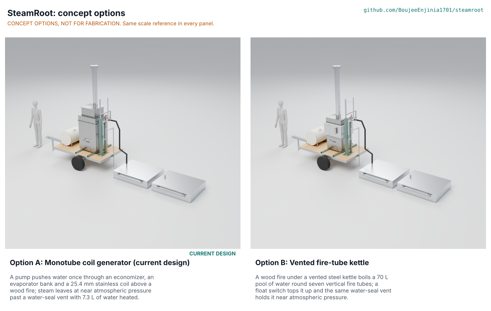

# SteamRoot concept options

Option A, the current monotube coil generator, scores 132 of 180 against option B, a vented fire-tube kettle, at 120; the gap is 9.1 %, inside the 10 % band, so both go to Amish without a pick (STR-DDR-004, STR-DEC-001 #14). A keeps its lead on fuel use, low stored energy and the regulatory case; B is simpler to run and to build and tolerates a pump stop. The repo stays on option A, the design Amish has been deciding since 2026-09-25, until he says otherwise. Method: STANDARDS section 21.

*Figure 1. Options A and B rendered from the D3 models in `cad/src/model.py` and `cad/src/str_option_b.py` at one scale with a 1.75 m person (`python .kit/options.py`; the Cycles render is made on Amish's workstation by the coordinator).*

> **Safety:** Both options are fired steam generators with open fire, carbon monoxide and steam that burns in under a second. Neither may be built before the written ruling from the Texas Department of Licensing and Regulation's boiler program (STR-REG-001, R1).

## The options

Both options use the same trailer, skids, 125 L feed drum, pump box, steam hose and the two insulated hoods, and the same header, water-seal vent, overflow, certified relief valve and diverter. They differ only in how the steam is raised, which is where the safety, fuel and regulatory questions sit.

### Option A: monotube coil generator (the current design)

A 12 V diaphragm pump pushes water once through a flue-gas economizer, an evaporator bank and a 25.4 mm stainless coil of 10 turns above a wood fire in a fibre-lined firebox. The water boils as it goes and leaves the coil as steam at about 0.03 bar, past the water seal (0.084 bar) to the hose. Only 7.3 L of water is heated at any time. Gas-pass baffles in the bank box and economizer (2026-10-24, STR-DEC-001 S1) make the flue gas cross the tubes. First-order numbers are from STR-CAL-001 v0.5: 66.1 % fuel to steam at λ = 1.5, 8.2 kg/h of wood, 4.36 kg/m2 at 15 cm, 1.88 m2/h with two hoods. Key risks: a dry coil if the feed stops (alarm, latching pump trip and refeed rule), efficiency depends on the dampers being set, tube bending and coil winding need care. A co-design partner would need to run the TRL 4 soil and flue measurements.

### Option B: vented fire-tube kettle

A wood fire in a lined firebox (600 x 500 x 450 mm) heats the 5 mm floor of a welded steel kettle (600 x 500 x 450 mm) and rises through seven vertical 60.3 mm fire tubes to a smoke box and the chimney. The kettle holds a pool of about 70 L at 100 °C, 250 mm deep; a float switch in a side chamber runs the same pump to keep the level, and steam leaves through a side nozzle to the shared header and water seal. The pool buffers a pump stop for many minutes, and on-off level control is simpler to set than a metered feed. Without an economizer the gas leaves the tubes hot (laminar flow, about 10 W/(m2 K)), so efficiency is about 50 % and the fire must be about 44 kW for 30 kg/h. Key risks: about ten times A's heated water as a scald inventory if the kettle is tipped or a weld fails; the flat walls cannot hold the relief valve's 1.03 bar set pressure if the seal freezes (STEM OB5), so it needs a second independent open vent and stiffened walls; about 25 min to bring the pool to the boil.

A third principle was considered and not developed: roasting excavated soil in a biomass-fired rotating drum. It changes the user-facing scope (digging, moving and replacing bed soil) and is not a steam method, so it does not serve the same user requirements.

## First-order numbers

Table 1. Options compared.

| Quantity | Option A | Option B |
| --- | --- | --- |
| Estimated parts cost (USD) | 2,720 (priced BOM) | About 2,300 (first-order: less the coil, bank, economizer and their fittings, about USD 600; plus kettle plate, fire tubes, smoke box, jacket and level controls, about USD 250; not priced line by line) |
| Mass, model, dry, both hoods (kg) | 507 (`cad/fidelity.json`); 509 drained by STR-CAL-001 | 457 (`cad/fidelity.json`); plus about 70 kg of water while running |
| Output | 30 kg/h; 1.88 m2/h at 15 cm with two hoods | 30 kg/h at about 44 kW firing; the same hood rate once boiling |
| Energy | 66.1 % fuel to steam; 8.2 kg/h of wood; 4.36 kg/m2 at 15 cm | About 50 %; about 10.8 kg/h; about 5.8 kg/m2 |
| Water heated | 7.3 L | About 70 L |
| Start-up to steam | Not calculated; 5 L in the coil | About 25 min |
| Parts count (D3 model) | 585 | 486 |
| STEM check | No Fails; S6, S7, S12 and E2 fixed (baffles, 3.2 m chimney, latching trip); S11 and B4 fail with fixes sent to Amish | No Fails; OB5 fails with a fix (second vent, stiffened walls); shares S11 and B4 |

## Scoring

Table 2. Weighted scoring against STR-URS-001 (weights: High UR 3, Medium 2, Low 1; scores 1 to 5). Cost, buildability and safety are the user requirements UR-009, UR-012 and UR-005, UR-007 and UR-011; maintenance is added as the template asks.

| Criterion | Source | Weight | A | B | Reason |
| --- | --- | --- | --- | --- | --- |
| Clear weeds and disease to 15 cm | UR-001 | 3 | 4 | 4 | Same hoods and steam rate; both limited by soil permeability (S11) |
| Treat beds at a useful rate | UR-002 | 3 | 4 | 3 | Same steam limit; B loses about 25 min of each day bringing the pool to the boil |
| Steam continuously from one fire | UR-003 | 2 | 3 | 5 | B's pool rides through a pump stop; A's coil dries in minutes without feed |
| Use local wood, sparingly | UR-004 | 3 | 4 | 2 | 66.1 % against about 50 %: B burns about a third more wood per m2 |
| Never a pressure vessel; little stored energy | UR-005 | 3 | 5 | 2 | 7.3 L in small tubes against about 70 L behind flat walls that cannot hold the relief set pressure |
| Run between refills | UR-006 | 2 | 4 | 4 | Same drum; both fills last over 4 h (battery to confirm in both) |
| Protect the operator and site | UR-007 | 3 | 4 | 3 | B's scald inventory is ten times larger if a weld fails or the kettle tips |
| Tow with farm vehicles | UR-008 | 3 | 3 | 4 | A at 509 kg against 500 kg (not met); B about 50 kg lighter dry |
| Affordable for a small farm or cooperative | UR-009 | 2 | 2 | 3 | USD 2,720 against about USD 2,300, both over the USD 2,200 target |
| One trained operator with a helper nearby | UR-010 | 3 | 3 | 4 | Same hoods (B4 applies to both); B's float control is simpler than setting a metered feed and dampers |
| Clear the authority's ruling | UR-011 | 3 | 4 | 2 | A has two independent means (seal, relief valve) on small tubes; B needs a second open vent and stronger walls first |
| Buildable in a farm workshop | UR-012 | 2 | 3 | 4 | B is plate welding; A needs a wound coil, two bent serpentines and more compression fittings |
| Fire outdoors, steam into tunnels | UR-013 | 2 | 4 | 4 | Same hose and hoods |
| Open reference design | UR-014 | 1 | 4 | 4 | Both documented to the same level |
| Maintenance | Template | 1 | 3 | 4 | A's coil and bank scale and need descaling; B's floor and tubes can be brushed and the kettle drained |
| **Weighted total (of 180)** | | | **132** | **120** | |

## Recommendation

The two options are within 10 % (A 132, B 120, a 9.1 % gap), so both go to Amish without a pick, as STANDARDS section 21 requires. Proposed, awaiting Amish (STR-DEC-001 #14): choose A or B. The repo is not redesigned without his go; option A stays the design carried by the drawing, BOM and build plan.

The runner-up's best idea to graft onto A is B's tolerance of a feed interruption: A could detect a feed loss directly, with a flow switch on the feed line that sounds the alarm the moment the pump stops, instead of waiting for the coil outlet to overheat (STEM E2). This is a suggestion in `docs/REVIEW.md`, not a change made.
